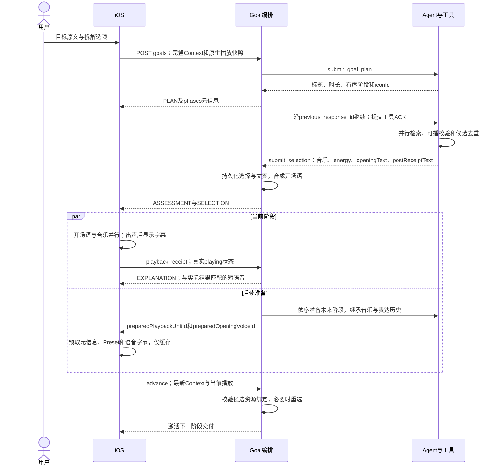

# 前后端数据流

## 创建、分批交付与执行

- API前缀`/agentic-player/api/v2`。`POST goals`先返回planning；后台计划返回PLAN。客户端轮询`GET goals/{id}?after=N&waitSeconds=20`，同时取最新阶段元信息和交付增量。
- 上传`input/split/language`、`clientSessionId/clientActionSeq/decisionVersion`、`context/currentPlayback`及可选catalog。Context沿用Auto的时间、授权定位、本地健康摘要、推荐结果和会话信息；后端补POI/天气与可信音乐画像。原始健康和压力算法留在iOS。
- 首阶段SELECTION交付后立即准备未来阶段，不等下一阶段开始。未来阶段依序准备共享去重历史，同一检索回合的工具并行。iOS另有独立元信息轮询和未来材料缓存，避免被当前语音阻塞。
- Goal的ASSESSMENT承载已选音乐的阶段开场语与energy，不是独立前置sensing模型请求。submit_selection共同提交音乐、energy、开场语和回执后短句；同一工具链允许多次模型往返。
- 原生执行后上传goal/version/phase/run与实际playbackUnitId/songId、success、actualPlaybackState、changeKind。成功且真实playing回执确认后才active并计时。
- 正常主候选回执复用预生成postReceiptText；实际候选不匹配等兼容路径才补模型解释；失败/技术降级静音。前端等开场语结束再播解释。音乐与开场语并行、不压低音量。

## 生命周期接口

| 路径（同一前缀） | 作用 |
| --- | --- |
| POST goals/{id}/playback-receipt | 原生执行确认，触发解释 |
| POST goals/{id}/progress | 实际elapsedSeconds、isPlaying和manualOverride |
| POST goals/{id}/advance | 下一阶段或最后阶段完成 |
| POST goals/{id}/retry | 当前阶段重选，保留已播进度 |
| POST goals/{id}/cancel | 结束会话，隔离迟到结果 |
| GET voice/{voiceId} | 语音下载；音乐资源/Preset仍由原服务分发 |

iOS约每5秒上报进度，准备/暂停不计时；到时或显式下一阶段请求advance。计划到时不代表现实目标已完成。结束保留音乐，不重播欢迎、不自动重启Auto。

未来prepared材料不驱动native加载、Touchpad点位和语音播放；推进时更新Context并检查资源绑定，不等于环境变化必重新模型判断，也未实现持续感知。

后端按版本、活动阶段、run、attempt和控制序号拒绝旧操作；前端按goal/phase/version与sequence筛交付。替换创建新目标并取消旧目标。手动接管清理当前待应用结果和未来准备；继续适配先取服务端最新元信息再重试。
